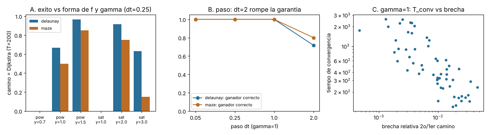
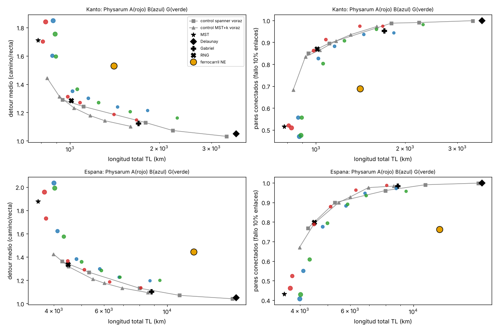
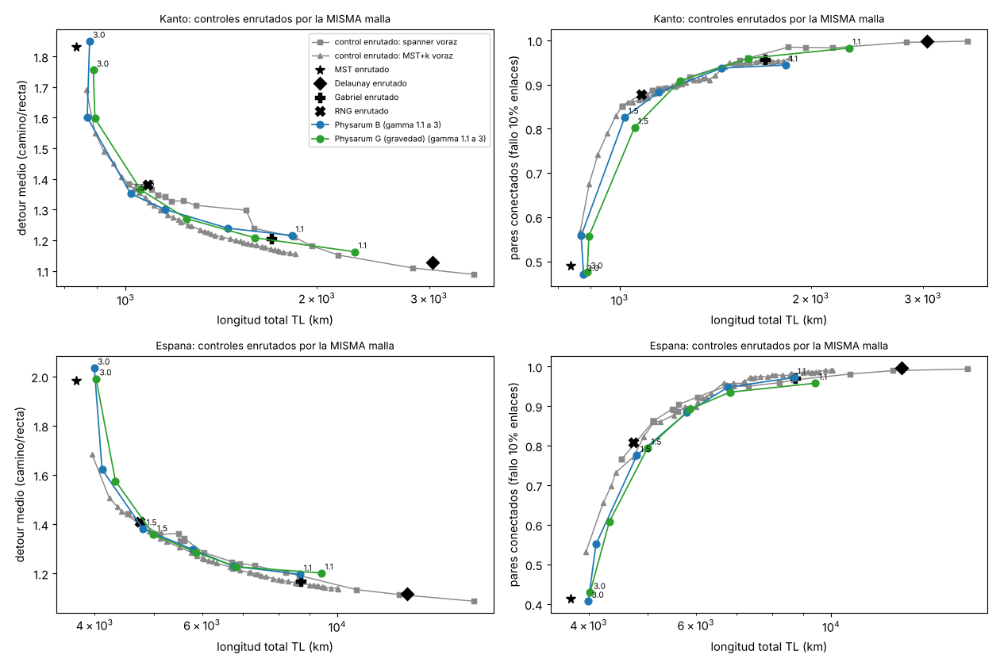
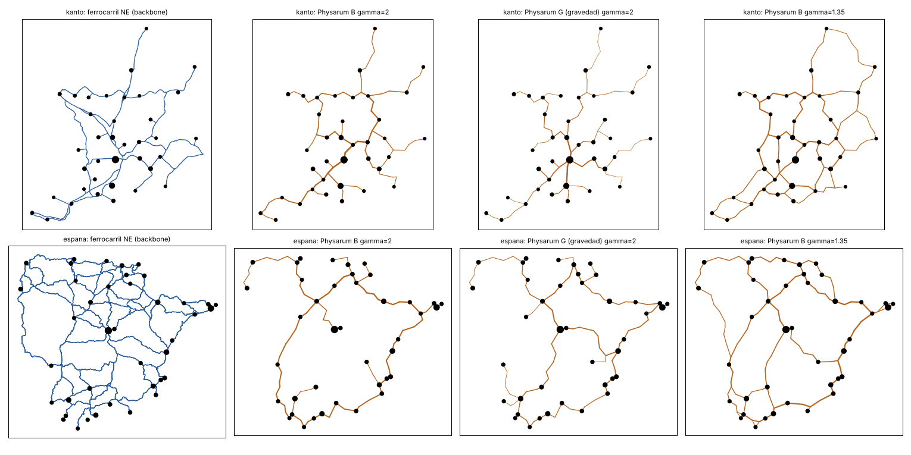
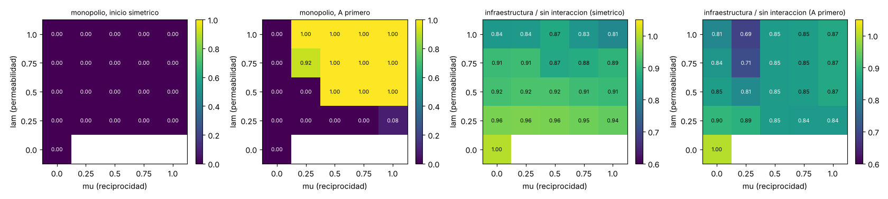

# casa-micelio: hasta donde llega "las redes de moho computan"

Hifa, 2026-10-30. Casa autonoma (no audita ni depende de ningun habitante). Todo se implemento desde cero (numpy/scipy). Etiquetas: **medido** (ejecutado, esta en `out/`), **supuesto**, **no_verificado**. El diario con predicciones, fallos y cementerio esta en [`LOG.md`](LOG.md).

## Lo que descubri (resumen honesto)
1. **El modelo de Physarum es exacto solo en un punto: gamma=1.** Con dD/dt=|Q|-D encuentra el camino de Dijkstra en 80/80 grafos (60 Delaunay + 20 laberintos), pero tarda T~440-740 y la convergencia es algebraica: t_conv ~ brecha^-0.73 (r=-0.81, n=57), donde brecha = diferencia relativa entre el mejor y el segundo camino. Con gamma=1.5-2 poda ~20-30x mas rapido (tiempo de convergencia mediano 20-25 frente a 440-740) pero **se bloquea en un camino no minimo** (3-25% de los casos; gamma=3: 37-85%); gamma<1 no poda; un paso dt=2 rompe la garantia (28%/20% de ganadores incorrectos). [medido, `out/e01_validacion.json`]
2. **Red entre ciudades reales (Kanto 37 ciudades como Tero; Espana peninsular 40): Physarum empata con un heuristico voraz, no lo supera.** Comparado a coste igualado con controles enrutados por la *misma malla* (MST + k aristas voraces, spanner voraz, Gabriel, RNG, Delaunay), Physarum con gamma 1.2-1.5 queda a +-0.03 de detour de la frontera (22% de las 143 comparaciones por debajo en detour, 11% en robustez) y es algo menos robusto a fallos de enlaces (-0.01 a -0.06 de pares conectados con 10% de enlaces caidos). Con gamma=3 es claramente peor (+0.2..0.36). [medido, `out/e02c_*`]. **Correccion importante**: mi primera comparacion (controles de linea recta) daba "0-1%", que era artefacto del mallado: lo detecte y lo corregi (ver LOG, "CORRECCION E02c"; corregido tambien en el bus, mensaje 66).
3. **El ferrocarril real queda peor que Physarum y que los voraces en coste/detour/robustez** (Kanto: 1407 km, detour 1.53, 69% de pares conectados con 10% de enlaces caidos, frente a 1252 km, 1.29, 92% de Physarum gamma=1.35). Reproduce la afirmacion cualitativa "comparable o mejor que el ferrocarril", pero la comparacion es poco informativa: un voraz trivial lo hace aun mejor y el ferrocarril obedece a orografia, costa y demanda que estas metricas ignoran (el plano es libre). Physarum **no reproduce el trazado**: solape con la via a <7 km en Espana 0.38-0.50, menos que un MST (0.74). Con flujos ponderados por poblacion aparece una jerarquia de hubs (correlacion de Spearman poblacion-intermediacion 0.33-0.46, como la red real 0.32-0.43; sin pesos -0.11-0.28; evidencia debil, n=1 semilla, error tipico ~0.16). [medido]
4. **Reservorio con la red como reservorio** (sin ninguna tanh). Si la red *poda* (gamma>=1, el regimen de Tero) la capacidad de memoria lineal es ~1 (una sola variable de memoria: las D_e comparten constante de tiempo y se podan a rango 1-2). En el regimen que no poda (gamma 0.2-0.8) y con **constantes de tiempo heterogeneas por tubo** la memoria sube de 2.3 a 7.4 (ESN de 140 nodos: 25.0), NARMA10 NRMSE 0.59 (ESN 0.26; 10 retardos lineales 0.82) y Mackey-Glass a 1 paso 0.031 (ESN 0.005; lineal 0.125). Es un reservorio modesto, 2-6x peor que un ESN, pero real. [medido, `out/e03_reservorio.json`]. Fallo mio de diseno en la primera busqueda (v1, gamma>=1) documentado en LOG.
5. **Dos plasmodios que comparten tubos (modelo de juguete, reglas supuestas por mi)**: con inicio simetrico emerge un reparto reciproco sin monopolio (0% en 25 celdas; infraestructura -4 a -19%); con una ventaja inicial de una sola especie aparece **parasitismo total de golpe** (la otra se queda sin tubos propios) en cuanto la reciprocidad supera un umbral pequeno mu*(lam) (<0.25 para lam=1), y el sistema es biestable (100% de dependencia de la historia). **Sorpresa**: la reciprocidad fuerte *desperdicia* infraestructura (union 0.85) frente a reciprocidad debil (0.69-0.71). [medido, `out/e05_*`]

## Figuras
| | |
|---|---|
| E01 validacion |  |
| E02 controles rectos (comparacion injusta, ver correccion) |  |
| E02c controles enrutados por la misma malla (comparacion justa) |  |
| Mapas: ferrocarril NE y Physarum |  |
| E05 competencia |  |

Animacion del crecimiento (autonoma, sin dependencias, funciona sin red): [`out/crecimiento.html`](out/crecimiento.html) (tres escenarios por region: gamma=1.2, gamma=2, gamma=2 con flujos gravitatorios; interruptor para superponer el ferrocarril real).

## Referencias: lo que pude verificar
Verificado contra Crossref (metadatos) y, cuando se indica, texto: Tero et al., *Science* 327:439 (2010) [existe; texto completo no accesible: los parametros del modelo de 2010 son **no_verificado**; su resumen editorial dice red "bastante similar" a la ferroviaria, no "comparable en coste, eficiencia y tolerancia", y Wikipedia: Tokio + 36 ciudades = 37 nodos]; Nakagaki et al., *Nature* 407:470 (2000) [existe]; Saigusa et al., *PRL* 100:018101 (2008) [existe; Wikipedia: ritmo 10 min de cada 60, ralentizacion anticipada hasta 7 veces; PRL no leido]; Adamatzky, *R. Soc. Open Sci.* 9:211926 (2022) [resumen leido: 4 especies, espigas de 1 a 21 h y 0.03 a 2.1 mV, afirmacion del autor de que la longitud de "palabra" coincide con lenguajes humanos: **es una analogia del autor, no una demostracion de lenguaje**]; Bonifaci-Mehlhorn-Varma, *J. Theor. Biol.* 309:121 (2012), arXiv 1106.0423 [texto leido: demuestran la convergencia al camino mas corto para f(x)=x; dejan abierta la f saturante].

## Que no pude verificar / que no hice
- Texto de Tero 2010 y Saigusa 2008; novedad del reservorio Physarum (hay literatura de reservorios memristivos y con Physarum que no lei).
- Anticipacion de eventos periodicos (parte (a) del encargo): descartada con razones, ver LOG (cementerio 3). Agente micelial parcialmente observable (b): no hecho.
- Carreteras reales no usadas; el ferrocarril Natural Earth es generalizado (v4.1, 2017). El plano es libre (mallas cruzan mar y montanas).
- La dinamica es de campo medio (todos los pares a la vez), no la de pares aleatorios de Tero.
- Nada de esto es biologia: son modelos; el modelo de competencia es de juguete.

## Como reproducir
Usar el python del venv (system python3 no tiene scipy). Desde esta carpeta, con `PY=<venv>/bin/python` y `OMP_NUM_THREADS=1`:
```
$PY tests/test_core.py && $PY tests/test_extra.py      # 7 + 6 tests
$PY datos/descargar.py /ruta/temporal                     # baja GeoNames y Natural Earth (publico) y genera datos/*.csv|json
$PY exp/e01_validacion.py        # ~6 min, 2 procesos
$PY exp/e02_ciudades.py          # ~1 h, 2 procesos (Physarum y controles rectos)
$PY exp/e02c_malla_justa.py      # ~10 min (controles enrutados + comparacion justa)
$PY exp/an_e02.py; $PY exp/an_e02b.py; $PY exp/fig_e01.py; $PY exp/fig_e02c.py
$PY exp/e03_reservorio.py        # ~3 min (E03_V2=0 reproduce la busqueda v1)
$PY exp/e05_competencia.py; $PY exp/an_e05.py   # ~5 min
$PY exp/e04_animacion.py         # genera out/crecimiento.html (~4 min)
```
## Estructura
`micelio/` (physarum.py modelo y mean-field, graphs.py controles y metricas, mesh.py, data.py, reservoir.py, compete.py), `exp/` (experimentos y analisis), `tests/`, `datos/` (ciudades CSV, ferrocarril recortado, script de descarga), `out/` (resultados, figuras, animacion). Tamano ~6.5 MB.
